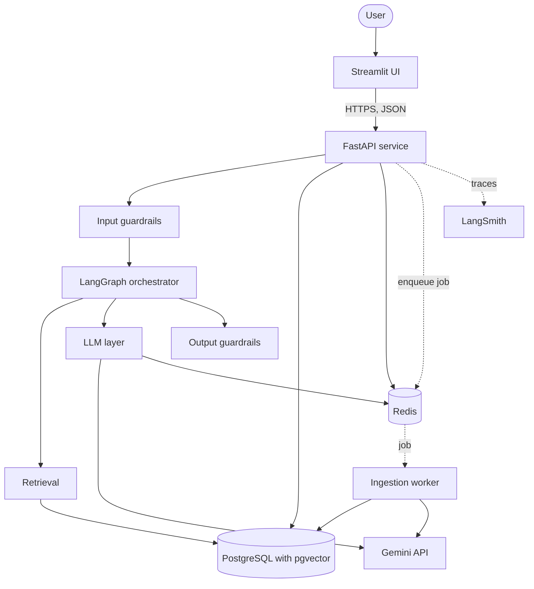
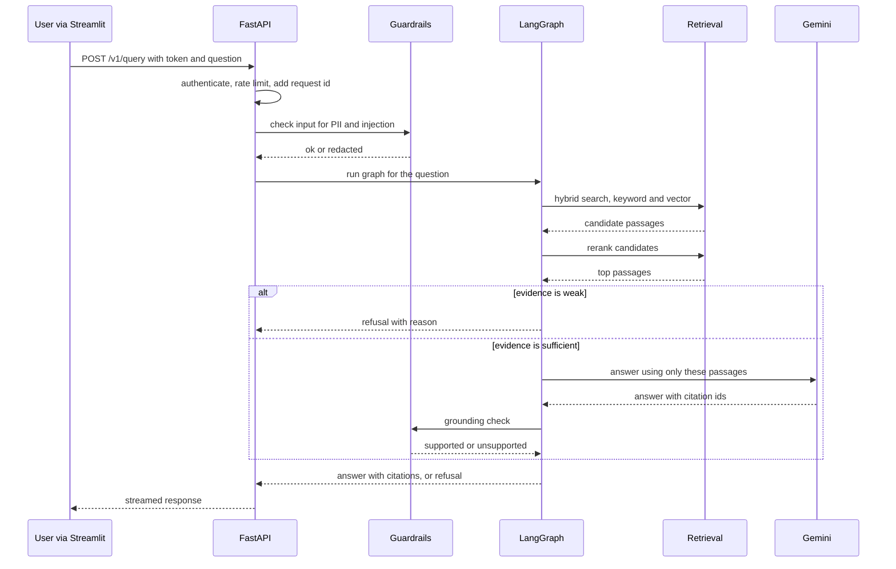
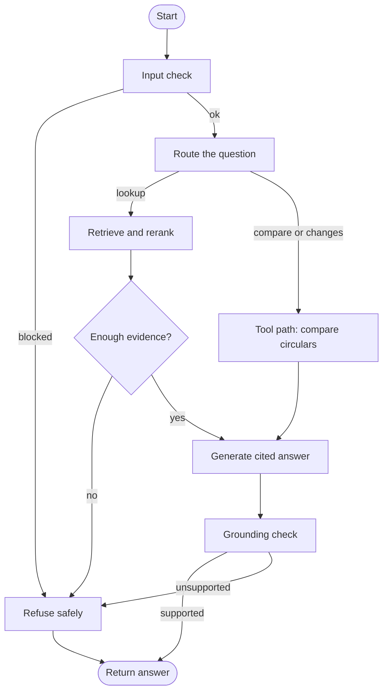
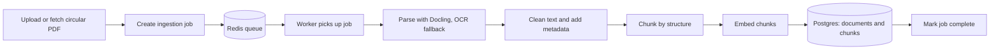
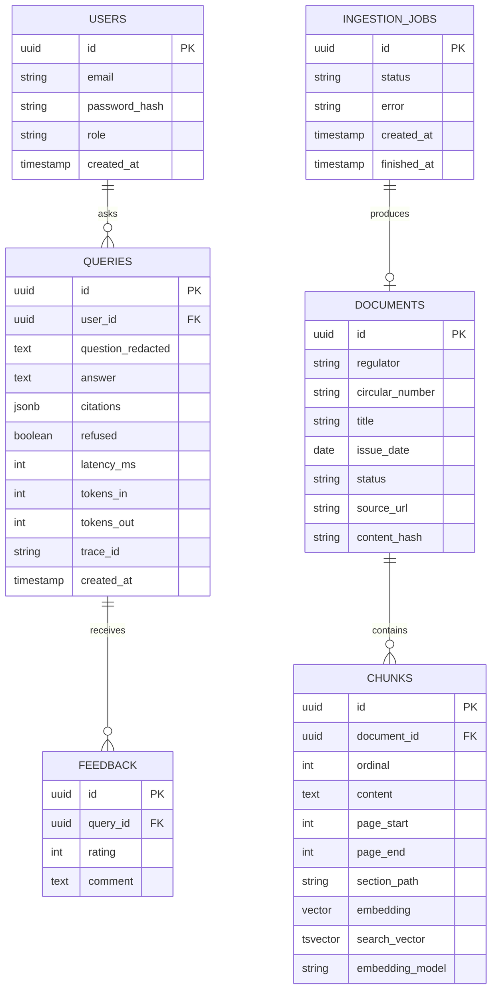

# Niyam architecture

Status of this document: living. Each phase of the build updates it. Sections describe the planned design, and the status table below says what exists today.

Related documents: `01-problem-and-solution.md` (why), `decision-log.md` (why each choice), `interview-notes.md` (process concepts).

## 1. Status

| Component | Phase | Status |
|---|---|---|
| Repo template, tooling, CI-ready checks | 1 | Built |
| Settings (environment driven) | 1 | Built |
| Structured logging | 1 | Built |
| Chat model factory | 1 | In progress |
| FastAPI service, Dockerfile, CI workflow | 1 | Planned |
| Database, migrations | 2 | Planned |
| Ingestion pipeline and worker | 3 | Planned |
| Hybrid retrieval and reranking | 4 | Planned |
| Evaluation harness | 5 | Planned |
| Cited answers, refusal behaviour | 6 | Planned |
| Authentication, rate limiting, streaming | 7 | Planned |
| LangGraph agent and tools | 8 | Planned |
| Fallback, caching, cost tracking | 9 | Planned |
| Guardrails and red-team tests | 10 | Planned |
| Observability | 11 | Planned |
| Deployment and CI evaluation gate | 12 | Planned |

## 2. Goals that shape the architecture

- **Grounded answers.** Every answer cites source passages, or is an explicit refusal.
- **Measurable quality.** Retrieval and answer quality are evaluated on a labelled question set, and every change is judged by those numbers.
- **Model independence.** Providers and model names are chosen by configuration only.
- **Production practices.** Typed code, tests, structured logs, tracing, security controls, containers, CI/CD and a live deployment.
- **Explainability.** Each component has one job that can be described in a sentence.

Targets and non-goals are in `01-problem-and-solution.md`.

## 3. Architectural principles

1. **Modular monolith plus one worker.** One application with strict package boundaries, and a separate worker process for slow ingestion work (D-001).
2. **Dependencies point downward.** A package may import from packages below it, never above (section 5).
3. **Third-party frameworks stay behind our own modules.** LangChain and LangGraph types are used only inside `llm`, `retrieval` and `agents`. The API, database and evaluation layers use our own Pydantic models (D-004, D-014).
4. **Configuration, not code.** Anything likely to change, such as model names, lives in environment variables read by one settings object (D-003, D-009, D-013).
5. **Fail fast and say why.** Invalid configuration stops the application at startup with a clear message.
6. **Measure before improving.** The evaluation set exists before the generator, and later changes are compared against it (D-011).
7. **Refuse rather than guess.** Weak evidence leads to a clear refusal, never an invented answer.
8. **Everything observable.** Every request carries a request ID and can be traced end to end.

## 4. System context and containers



| Container | Responsibility | Talks to |
|---|---|---|
| Streamlit UI | Chat page, citation display, admin upload page, feedback buttons. Holds no business logic | FastAPI over HTTP |
| FastAPI service | Authentication, rate limiting, request IDs, streaming, request validation | Postgres, Redis, orchestrator |
| LangGraph orchestrator | Decides what to do with a question and runs the steps | Retrieval, LLM layer, guardrails |
| Retrieval | Keyword search, vector search, fusion, reranking | Postgres |
| LLM layer | Builds chat and embedding models from configuration, retries, fallback, cache, cost tracking | Gemini, Redis |
| Guardrails | Input checks (PII, prompt injection), output checks (grounding, PII) | Nothing external |
| Ingestion worker | Parses, cleans, chunks, embeds and stores documents | Postgres, Redis, Gemini |
| PostgreSQL with pgvector | Documents, chunks, vectors, full-text index, users, query history | n/a |
| Redis | Job queue, rate-limit counters, response cache | n/a |
| LangSmith | Traces of LLM calls, retrieval steps and experiments | n/a |

## 5. Code structure and dependency rules

```
src/niyam/
  core/        settings, logging, errors, security helpers
  db/          models, migrations, repositories
  llm/         chat and embedding model factories, retry, fallback, cache, cost
  retrieval/   keyword search, vector search, fusion, reranker
  guardrails/  input and output checks, PII redaction
  agents/      LangGraph graph, nodes, tools
  ingestion/   parsers, chunkers, pipeline, worker entry point
  evals/       datasets, metrics, runners
  api/         routes, schemas, dependencies, startup
tests/         unit, integration, evaluation
deploy/        Dockerfile, compose files, CI workflows
docs/          architecture, decision log, notes
```

Allowed import direction (an arrow means "may import from"):

```
api -> agents -> retrieval, llm, guardrails -> db -> core
ingestion -> llm, db -> core
evals -> agents, retrieval (public functions only)
```

Rules:
- A lower package never imports an upper one. For example `db` never imports `agents`.
- Only `llm`, `retrieval` and `agents` import LangChain or LangGraph.
- Only `db` talks to Postgres directly.
- Only `llm` builds models, and it is the only place that opens the API key.
- The rules will be enforced automatically later, for example with an import-linter contract (to be decided).

## 6. Main flow: answering a question



### 6.1 Orchestration graph



Graph state (kept small and typed): the question, redacted question, route, retrieved passages, answer draft, citations, refusal reason, and request id. LangGraph checkpointing is used where a conversation needs to resume.

### 6.2 Retrieval design

1. **Keyword search.** Postgres full-text search over each chunk, useful for exact terms such as section numbers and defined terms.
2. **Vector search.** Cosine similarity over chunk embeddings with pgvector, useful for paraphrased questions.
3. **Fusion.** Reciprocal rank fusion merges the two ranked lists. Each result scores the sum of `1 / (k + rank)` across lists, with `k` commonly set to 60 (to be tuned).
4. **Reranking.** A cross-encoder reranks the top candidates against the question.
5. **Evidence check.** If the best score is below a threshold, the system refuses. The threshold is tuned on the evaluation set.

Each stage can be switched off by configuration, so the evaluation harness can measure its contribution.

### 6.3 Generation rules

- The prompt contains only the retrieved passages and the question, with each passage labelled by an id.
- The model must cite passage ids. Claims without a supporting id are rejected by the grounding check.
- The answer includes the circular name, date and status, so the user can see whether a source is current.

## 7. Ingestion flow



- **Idempotent.** Each document stores a content hash. Re-ingesting the same file does not create duplicates.
- **Retries.** A failed step is retried with backoff, and a permanent failure marks the job as failed with a reason.
- **Metadata.** Regulator, circular number, issue date, status (active, superseded, withdrawn) and source URL are stored per document.
- **Chunking.** Structure-aware chunking is compared with fixed-size chunking in the evaluation phase (open decision).
- **Embedding model recorded.** Each chunk stores the embedding model name and vector size. At startup, the application checks them against configuration and refuses to start on a mismatch, because vectors from different models cannot be compared.

## 8. Data model (planned)



- Schema changes go through versioned Alembic migrations.
- Indexes: a GIN index on the full-text column, and a vector index (HNSW or IVFFlat, chosen by measurement) on embeddings.
- Only redacted question text is stored.

## 9. API surface (planned)

| Endpoint | Purpose | Access |
|---|---|---|
| `GET /health` | Process is alive | Public |
| `GET /ready` | Database and Redis reachable | Public |
| `POST /v1/auth/login` | Exchange credentials for a token | Public |
| `POST /v1/query` | Ask a question, streamed response | User |
| `POST /v1/feedback` | Rate an answer | User |
| `GET /v1/documents` | List ingested documents | User |
| `POST /v1/admin/documents` | Upload a document for ingestion | Admin |
| `GET /v1/admin/ingestion/{job_id}` | Ingestion job status | Admin |

Responses use Pydantic schemas. Every response carries the request id. Errors use one consistent error shape.

## 10. Security and privacy

| Risk | Control |
|---|---|
| Stolen or guessed credentials | Password hashing with a modern algorithm, short-lived tokens, role checks |
| Abuse and cost blow-ups | Per-user rate limits in Redis, request size limits |
| Secrets in code or logs | Environment variables, a git-ignored `.env`, `SecretStr` for keys, a test that checks secrets do not print |
| Prompt injection from the user | Input checks and a red-team test set with a measured attack success rate |
| Prompt injection hidden in documents | Document text is treated as data, never as instructions. The prompt says so, and tests include poisoned passages |
| Personal data in questions | Redaction before logging, tracing and storage |
| Over-powerful tools | Tools are read-only and limited to the document store |
| Vulnerable dependencies | Lockfile, dependency scanning in CI (to be added) |

The ingested corpus is public regulation only. No private documents are in scope.

## 11. Reliability and cost

| Failure | Behaviour |
|---|---|
| Gemini rate limit or timeout | Retry with backoff, then fall back to the configured fallback model, then return a clear error |
| Database unreachable | `/ready` fails, and requests return a clear service-unavailable error |
| Redis unreachable | The cache is skipped and the request continues. Rate limiting fails closed or open by configuration (to be decided) |
| No relevant passages | Refusal with a reason |
| Ungrounded draft answer | Refusal, never a guess |
| Document parse failure | Job marked failed with a reason, and other jobs continue |

Cost controls: a response cache (exact match first, semantic cache evaluated later), token and cost recorded per query, and a cheaper model for routing steps than for answers.

## 12. Observability

- **Logs.** Structured JSON in production, readable output locally, with a request id on every line.
- **Traces.** LangSmith traces for each graph run, with retrieval, rerank, generation and grounding steps visible. OpenTelemetry covers the API and database layers.
- **Metrics.** Latency per stage, tokens and cost per query, error rate, refusal rate and cache hit rate.
- **Feedback.** User ratings are stored against the query and the trace id.
- Personal data is redacted before it is traced.

## 13. Evaluation architecture

- **Datasets.** A labelled question set kept in the repository, with expected source passages for each question.
- **Retrieval metrics.** recall@k and MRR, computed per retrieval variant (keyword only, vector only, fused, reranked).
- **Answer metrics.** Faithfulness and relevance (RAGAS), refusal accuracy, and citation correctness.
- **Agent metrics.** Tool selection accuracy and path correctness.
- **Experiments.** Results are compared in LangSmith, and the final tables go into the README.
- **CI gate.** Evaluations run on every pull request. A drop below agreed thresholds blocks the merge.

## 14. Environments and deployment

| Environment | Purpose | How it runs |
|---|---|---|
| Local | Development | Docker Compose for Postgres and Redis, the app run with uv |
| CI | Automated checks | GitHub Actions with service containers |
| Production | Live demo | Containers on a managed cloud service with managed Postgres and Redis. The cloud target is an open decision |

- **One image per deployable** (API and worker), built once and promoted unchanged between environments.
- **Configuration through environment variables** only.
- **Migrations** run as a separate step before the new version starts.
- **Health and readiness endpoints** are used by the platform for restarts and routing.

## 15. Testing strategy

| Layer | What it proves | Examples |
|---|---|---|
| Unit | One function or class behaves correctly | Settings validation, fusion scoring, chunkers |
| Integration | Pieces work together | API with a test database, ingestion into Postgres |
| Contract | Boundaries behave as promised | The model factory with a fake model, tool schemas |
| Evaluation | Quality of retrieval and answers | Golden set metrics and thresholds |
| Security | Safety properties hold | Secrets do not print, injection attack set |

Tests never need real API keys: model calls are replaced by fakes, with a small number of marked live tests that run on demand.

## 16. Delivery pipeline

1. **Pre-commit (local).** Format, lint (to be added).
2. **CI on every push.** Format check, lint, strict type check, unit and integration tests.
3. **CI on pull requests.** Evaluation suite with threshold gate.
4. **Build.** Container images tagged with the commit.
5. **Deploy.** Migrations, then rollout, then a readiness check.

## 17. Technology summary

| Area | Choice |
|---|---|
| Language and tooling | Python 3.12, uv, ruff, mypy strict, pytest |
| API | FastAPI, Pydantic v2 |
| Data | PostgreSQL with pgvector and full-text search, SQLAlchemy 2, Alembic |
| Cache, queue, limits | Redis, Arq for background jobs |
| LLM and embeddings | Gemini through LangChain, selected by configuration |
| Orchestration | LangGraph |
| Parsing | Docling with OCR fallback |
| Evaluation | Custom retrieval metrics and RAGAS, LangSmith experiments |
| Guardrails | Presidio for PII, injection test set, grounding check |
| Observability | LangSmith, OpenTelemetry, structured logs |
| Frontend | Streamlit |
| Delivery | Docker, GitHub Actions, managed cloud deployment |

## 18. Open decisions

Tracked in `decision-log.md`: chunking strategy, embedding model, reranker choice, vector index type, rate-limit failure mode, cache design, and deployment target.

## 19. Known limitations and risks

- Answer quality depends on parsing quality. Scanned or table-heavy circulars may be parsed imperfectly.
- Circulars can be superseded. Status metadata helps, but the corpus must be kept current by hand.
- The system answers from its curated corpus only and does not give legal advice.
- Free-tier model and tracing limits may constrain throughput during evaluation runs.